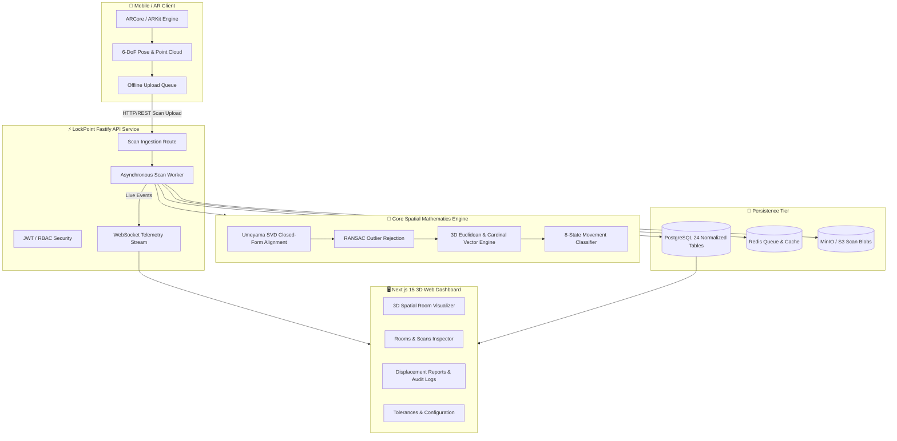

# 📍 LockPoint: Spatial Object Movement & Indoor Tracking Engine

<div align="center">

[](https://lockpoint.vercel.app)
[](https://github.com/hasim2006/LockPoint)
[](https://nextjs.org/)
[](https://react.dev/)
[](https://www.typescriptlang.org/)
[](https://fastify.dev/)
[](LICENSE)

<br/>

**Production-grade full-stack spatial computing system that detects, locks, stores, and measures the physical movement of objects inside indoor environments using smartphone cameras, computer vision, and ARCore/ARKit spatial mapping.**

[Explore Live Demo](https://lockpoint.vercel.app) • [View Architecture](#-system-architecture) • [Quickstart Guide](#-quickstart--local-development) • [API Reference](#-api-endpoints)

---

</div>

## 🌐 Public Deployment & Live Links

- 🚀 **Live Production Web App**: [https://lockpoint.vercel.app](https://lockpoint.vercel.app)
- 📦 **GitHub Repository**: [https://github.com/hasim2006/LockPoint](https://github.com/hasim2006/LockPoint)
- 👨‍💻 **Author**: [Mohammad Hasim (@hasim2006)](https://github.com/hasim2006)

---

## ⚡ Overview & Core Capabilities

LockPoint solves the spatial drift and position tracking problem in physical indoor environments. By fusing mobile AR feature points, planar anchors, and camera poses with real-time $SE(3)$ rigid body transformations, LockPoint creates centimeter-accurate physical displacement measurements over time.

### 🎯 Key Highlights

- **📐 Spatial Map Registration**: Re-aligns distinct temporal scans across multiple sessions using the **Umeyama algorithm** with **RANSAC outlier rejection** ($SE(3)$ closed-form rigid alignment).
- **🧭 Physical Displacement Engine**: Computes exact Euclidean, horizontal ($XZ$), and vertical ($Y$) displacements, cardinal relative directions (N, NE, E, SE, S, SW, W, NW), 3D rotation differences, and composite confidence scores.
- **🏷️ Multi-State Movement Classifier**:
  - `STABLE`: Displacement within sensor noise threshold ($< 2\text{ cm}$)
  - `MINOR_MOVEMENT`: Positional drift between $2\text{ cm}$ and $10\text{ cm}$
  - `SIGNIFICANT_MOVEMENT`: Clear physical relocation ($> 10\text{ cm}$)
  - `ROTATED_ONLY`: Positional shift $< 2\text{ cm}$ but orientation delta $\ge 15^\circ$
  - `NEW_OBJECT`: Present in current scan but absent in baseline
  - `DISAPPEARED`: Missing from current scan within camera visibility frustum
  - `OCCLUDED`: Blocked by another foreground obstacle or bounding box
  - `UNCERTAIN_TRACKING`: High registration RMSE or low feature point confidence
- **🖥️ Interactive 3D Web Dashboard**: Next.js 15 web application with custom HTML5 Canvas/WebGL 3D visualizer, coordinate grids, bounding boxes, and displacement vector arrows.
- **📱 Mobile ARCore Native Bridge**: Kotlin native Android module capturing camera poses, planar anchors, and 3D point cloud feature points.
- **⚡ Fastify Real-time Telemetry**: High-throughput REST and WebSocket service providing sub-10ms spatial telemetry updates.

---

## 🏗️ System Architecture



---

## 📂 Monorepo Structure

```
lockpoint/
├── apps/
│   ├── web/               # Next.js 15 Web Dashboard & 3D Spatial Room Visualizer
│   ├── api/               # Fastify REST & WebSocket Telemetry Server
│   └── mobile/            # React Native / Kotlin ARCore Scanner Module
├── packages/
│   ├── types/             # Domain models, Vector3D, DTOs, MovementStatus Enums
│   ├── config/            # Configurable movement thresholds, tolerances, & ports
│   ├── spatial/           # 3D Math, Umeyama SVD, RANSAC, Movement Engine
│   ├── cv/                # Object detector interfaces, raycasting, synthetic simulator
│   ├── database/          # Prisma schema (24 relational tables) & memory store
│   ├── auth/              # JWT tokens & RBAC permissions service
│   └── observability/     # Structured JSON logger & health telemetry
├── infra/
│   ├── docker/            # Dockerfiles & docker-compose.yml (PostgreSQL, Redis, MinIO)
│   └── terraform/         # Cloud deployment infrastructure as code
├── docs/
│   ├── ARCHITECTURE.md    # Detailed system design & pipeline breakdown
│   └── COORDINATES.md     # 3D coordinate frames & spatial reference conventions
└── tests/
    ├── fixtures/          # Deterministic spatial scan test scenarios
    └── unit/              # Umeyama, vector math, and movement engine tests
```

---

## 🚀 Quickstart & Local Development

### Prerequisites
- **Node.js**: v18.0.0 or higher (v20+ recommended)
- **npm**: v9.0.0 or higher
- **Docker & Docker Compose** (optional, for full containerized stack)

### 1. Clone the Repository
```bash
git clone https://github.com/hasim2006/LockPoint.git
cd LockPoint
```

### 2. Install Dependencies
```bash
npm install
```

### 3. Environment Configuration
Copy `.env.example` to create your local environment:
```bash
cp .env.example .env.local
```

### 4. Run the Test Suite
Validate the spatial mathematics algorithms and movement engine:
```bash
npm test
```

### 5. Launch Development Servers
You can run the web dashboard, API, or both concurrently:

```bash
# Run both Frontend & Backend concurrently
npm run dev

# Or launch services individually:
npm run dev:web  # Web Dashboard at http://localhost:3000
npm run dev:api  # API Service at http://localhost:4000
```

---

## 🐳 Docker Deployment

To launch the complete production stack (PostgreSQL, Redis, MinIO Object Storage, API, and Web Visualizer) with one command:

```bash
docker compose -f infra/docker/docker-compose.yml up --build -d
```

- **Web Dashboard**: `http://localhost:3000`
- **Fastify API**: `http://localhost:4000`
- **API Swagger Docs**: `http://localhost:4000/docs`
- **MinIO Console**: `http://localhost:9001` (User: `minioadmin`, Pass: `minioadmin`)

---

## 📡 API Endpoints

| Method | Endpoint | Description |
| :--- | :--- | :--- |
| `GET` | `/api/v1/health` | Service health status & memory metrics |
| `POST` | `/api/v1/auth/login` | Authenticate user and issue JWT access token |
| `GET` | `/api/v1/rooms` | Retrieve list of registered spatial rooms |
| `POST` | `/api/v1/rooms` | Register a new physical room and coordinate frame |
| `GET` | `/api/v1/rooms/:id/scans` | Fetch temporal scan history for a specific room |
| `POST` | `/api/v1/scans/upload` | Ingest AR point cloud, planar anchors, and camera poses |
| `GET` | `/api/v1/objects` | Query tracked physical objects with filters |
| `GET` | `/api/v1/movements` | Query detected displacements, cardinal directions, and status |
| `GET` | `/api/v1/admin/diagnostics` | Admin registration RMSE and tracking telemetry |
| `WS` | `/ws` | Real-time spatial event stream |

---

## 📊 Movement Status Reference

| Status | Threshold / Rule | Interpretation |
| :--- | :--- | :--- |
| `STABLE` | $\Delta \le 0.02\text{ m}$ | Object has not moved beyond sensor noise |
| `MINOR_MOVEMENT` | $0.02\text{ m} < \Delta \le 0.10\text{ m}$ | Object experienced slight physical shift or bump |
| `SIGNIFICANT_MOVEMENT` | $\Delta > 0.10\text{ m}$ | Object has been relocated or picked up |
| `ROTATED_ONLY` | $\Delta \le 0.02\text{ m} \land \Delta\theta \ge 15^\circ$ | Position unchanged, but object orientation rotated |
| `NEW_OBJECT` | Missing in Baseline Scan | Fresh object placed into the spatial frame |
| `DISAPPEARED` | In Frustum $\land$ Absent in Current | Object was removed from the tracked room |
| `OCCLUDED` | Raycast blocked by foreground | Tracking blocked by another physical entity |
| `UNCERTAIN_TRACKING` | $\text{RMSE} > 0.08\text{ m}$ | Scan alignment error exceeds confidence threshold |

---

## 🛠️ Tech Stack

- **Frontend**: [Next.js 15](https://nextjs.org/), [React 19](https://react.dev/), [Tailwind CSS](https://tailwindcss.com/), Lucide Icons
- **Backend**: [Node.js](https://nodejs.org/), [Fastify](https://fastify.dev/), WebSockets, TypeScript
- **Spatial Algorithms**: SVD Closed-form Umeyama Alignment, RANSAC, 3D Euclidean & Vector Projections
- **Database & Storage**: [PostgreSQL](https://www.postgresql.org/), [Prisma ORM](https://www.prisma.io/), [Redis](https://redis.io/), [MinIO](https://min.io/)
- **DevOps**: Docker, Docker Compose, Terraform, GitHub Actions CI

---

## 📜 License

Distributed under the **MIT License**. See [`LICENSE`](LICENSE) for more information.

---

<div align="center">

Designed and engineered with precision by **[Mohammad Hasim](https://github.com/hasim2006)**.

⭐ **If you find LockPoint useful, consider giving it a star on [GitHub](https://github.com/hasim2006/LockPoint)!**

</div>
